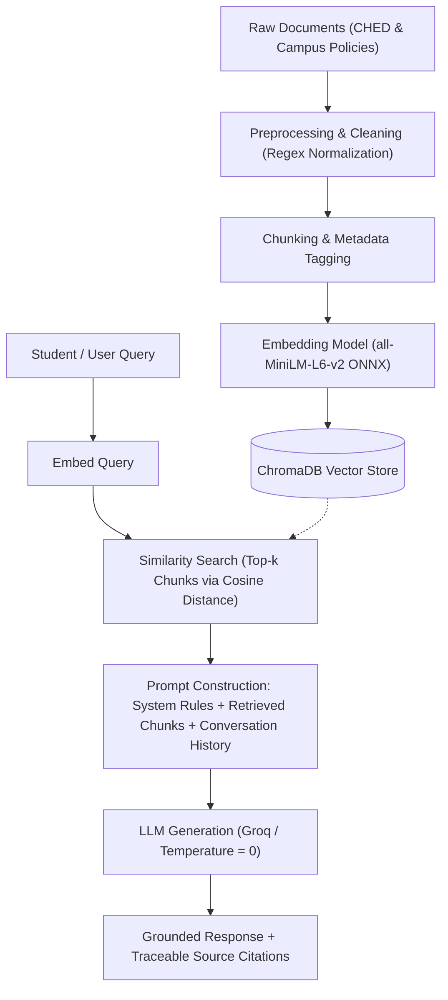

# PolyBot: Scholarship Information Assistant 🎓

An intelligent, grounded Retrieval-Augmented Generation (RAG) assistant designed to help college students easily navigate scholarship guidelines, eligibility criteria, documentary requirements, and application procedures — featuring the **CHED Merit Scholarship Program (CMSP)** and institutional scholarship policies.

---

## 🌐 Live Web Application
- **Deployed App Link**: [Insert your deployed Streamlit Community Cloud link here, e.g., `https://polybot-scholarship.streamlit.app`]
- **Public GitHub Repository**: [https://github.com/caryllimso2-cmd/polybot-scholarship](https://github.com/caryllimso2-cmd/polybot-scholarship)
- **Demo Video (Google Drive / YouTube Unlisted)**: [Insert your demo video link here]

*(Note: Open the live web app in any browser — no login or local installation required.)*

---

## 📌 Project Title & Purpose

### Title
**PolyBot: Scholarship Information Assistant**

### Purpose & Problem Statement
Every academic year, thousands of Filipino college applicants and undergraduate students struggle to find accurate, up-to-date scholarship information. Scholarship requirements, income thresholds, grade cutoffs, and required documentary proofs are often scattered across disparate government circulars, regional memorandums, and campus announcements. 

Students frequently miss deadlines or submit incomplete applications due to confusing guidelines, while scholarship officers are overwhelmed answering repetitive eligibility queries.

**PolyBot** solves this by providing a conversational Q&A assistant strictly grounded in official scholarship guidelines. By employing a Retrieval-Augmented Generation (RAG) architecture, PolyBot retrieves exact policy clauses before synthesizing an answer, citing verifiable sources and refusing to answer out-of-scope inquiries to avoid AI hallucination.

---

## 🛠️ Tech Stack & Architecture

| Layer | Component / Technology | Justification |
| :--- | :--- | :--- |
| **User Interface** | [Streamlit](https://streamlit.io/) | Lightweight, responsive web interface with native chat components (`st.chat_message`, `st.chat_input`) and source citation expanders. |
| **Orchestration Framework** | [LangChain](https://www.langchain.com/) | Manages prompt templates, multi-turn conversational history, context assembly, and LLM message payloads. |
| **Embedding Model** | `sentence-transformers/all-MiniLM-L6-v2` (ONNX Runtime) | 384-dimensional dense semantic embeddings; optimized via ONNX for sub-second vector inference and minimal memory overhead on cloud hosts. |
| **Vector Store** | [ChromaDB](https://www.trychroma.com/) | Persistent vector database using Cosine similarity metric ($hnsw:space = \text{cosine}$) for k-nearest neighbors retrieval. |
| **Inference Engine & LLM** | Groq Cloud API (`openai/gpt-oss-20b` or `llama3-8b-8192`) | Ultra-low latency LPU inference with temperature set to `0` for factual, deterministic responses. |
| **Language & Environment** | Python 3.10+ / `python-dotenv` | Standard data science & GenAI stack with strict separation of secrets. |

---

## 🔄 How the RAG Pipeline Works



1. **Document Ingestion & Preprocessing**:
   - Raw scholarship policies in `data/raw/` are ingested and normalized (removing invisible BOM headers, normalizing excess whitespace, and tagging with metadata: `title`, `source`, `filename`).
2. **Dense Vector Embedding**:
   - Each cleaned policy chunk is converted into a 384-dimensional dense vector using `all-MiniLM-L6-v2`.
3. **ChromaDB Indexing**:
   - Chunks, embeddings, and metadata are indexed in ChromaDB using Cosine distance. The application features auto-indexing on initial cloud boot if the vector store is not pre-populated.
4. **Context Retrieval**:
   - When a user asks a question, the query is embedded and compared against stored vectors to retrieve the top $k=3$ most semantically relevant policy passages.
5. **Grounded Generation & Anti-Hallucination**:
   - The retrieved passages, strict system rules, and prior chat turns are passed to the LLM. If the query cannot be answered from the retrieved context, PolyBot is instructed to explicitly refuse rather than fabricate details.
6. **Transparent Source Citation**:
   - Every answer displays an interactive "📚 Retrieved Sources & Grounding Passages" expander showing the document title, source agency, cosine similarity score, and excerpt.

---

## 📚 Knowledge Base & Dataset Sources

PolyBot's knowledge base comprises 25 curated scholarship records:

1. **CHED Merit Scholarship Program (CMSP)**:
   - Official guidelines from the **Commission on Higher Education (CHED)** Republic of the Philippines.
   - Reference: [CHED Official Merit Scholarship Portal](https://legacy.ched.gov.ph/merit-scholarship/)
   - Covers: General Weighted Average (GWA $\ge 93\%$) requirement, PHP 500,000 family annual gross income ceiling, accredited SUC/LUC/PHEI conditions, documentary requirements (ITR, Form 138, PSA Birth Certificate, Indigence/OFW contract), tuition coverage, stipends, and book/connectivity allowances.
2. **Institutional & Campus Scholarship Policy Templates** (24 files in `data/raw/`):
   - Structured policies covering Academic Honors, Need-Based Grants, Athletic/Cultural Grants, STEM scholarships, First-Generation college student assistance, renewal terms, appeals, and disbursement schedules.

---

## ⚡ API Quota & Usage Limit Notice

> [!NOTE]
> **Free-Tier API Rate Limits**: This project uses Groq's fast free-tier API. The rate limit is typically **30 requests per minute** and **14,400 requests per day**. If evaluating multiple queries in rapid succession, please allow a brief pause of a few seconds between prompts.

---

## 💻 How to Run Locally

### Prerequisites
- Python 3.10, 3.11, 3.12, or 3.13
- A free Groq API key from [console.groq.com](https://console.groq.com/) (or OpenAI API key)

### Step 1: Clone the Repository
```bash
git clone https://github.com/caryllimso2-cmd/polybot-scholarship.git
cd polybot-scholarship
```

### Step 2: Create and Activate a Virtual Environment
- **Windows (PowerShell)**:
  ```powershell
  python -m venv venv
  .\venv\Scripts\Activate.ps1
  ```
- **macOS / Linux**:
  ```bash
  python3 -m venv venv
  source venv/bin/activate
  ```

### Step 3: Install Dependencies
```bash
pip install -r requirements.txt
```

### Step 4: Configure Environment Variables
Copy the `.env.example` file to `.env`:
```bash
cp .env.example .env
```
Open `.env` and fill in your API key:
```env
LLM_API_KEY=gsk_your_actual_groq_api_key_here
LLM_BASE_URL=https://api.groq.com/openai/v1
LLM_MODEL=openai/gpt-oss-20b
```

### Step 5: (Optional) Pre-build Embeddings & Vector Index
```bash
python src/preprocess.py
python src/setup_chromadb.py
```
*(Note: If you skip this, `app.py` automatically initializes and indexes the database on first run!)*

### Step 6: Launch the Streamlit Web Application
```bash
streamlit run app.py
```
Your default browser will automatically open `http://localhost:8501`.

*(Alternatively, you can run the terminal CLI version using `python src/rag_chatbot.py`.)*

---

## ☁️ How to Deploy to Streamlit Community Cloud (Step-by-Step)

1. Push your repository to **GitHub** and set visibility to **Public**.
2. Go to [share.streamlit.io](https://share.streamlit.io/) and log in with your GitHub account.
3. Click **"New app"**.
4. Select your repository (`polybot-scholarship`), branch (`main`), and set the main file path to `app.py`.
5. Under **"Advanced settings..."** $\to$ **"Secrets"**, paste your API credentials:
   ```toml
   LLM_API_KEY = "gsk_your_groq_api_key"
   LLM_BASE_URL = "https://api.groq.com/openai/v1"
   LLM_MODEL = "openai/gpt-oss-20b"
   ```
6. Click **"Deploy!"**. Your public URL will be live within 1–2 minutes!

---

## 👥 Project Team
- **Carylflor Osmil** — Project Leader / System Integration & Documentation
- **Angelo Batausa** — Data Collection & Preprocessing
- **Ryan Rodriguez** — Vector Database, Embeddings & RAG Retrieval
- **Gevanny Autida** — Interface Design, Evaluation & Deployment
